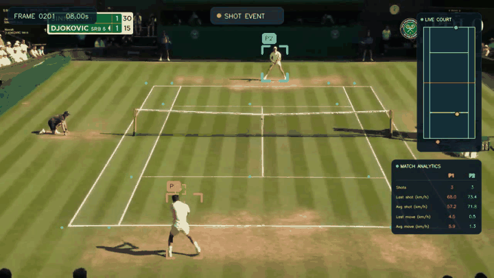

# Tennis Analysis System

[](https://github.com/stoppo22/tennis-analysis-system/actions/workflows/tests.yml)

Computer-vision pipeline that analyses broadcast tennis footage with Python,
OpenCV, PyTorch, and YOLO. Given a video, it detects the players and the ball,
estimates the court keypoints, maps movement onto a mini court, detects shot
events, estimates speeds, and produces an annotated video plus a per-frame
statistics CSV.



This silent six-second excerpt shows the system analysing Jannik Sinner vs
Novak Djokovic in the 2025 Wimbledon semifinal. The source footage comes from
the official Wimbledon YouTube channel:
[watch the original video](https://www.youtube.com/watch?v=eoiKSfYg71o). It was
shortened, resized, muted, and overlaid with detections to demonstrate the
system. The source footage is not freely licensed and is not covered by this
repository's software licence; the full video and benchmark clips are not
included.

## What it does

```text
video ─► player detection (YOLO11 + tracking) ─┐
      ─► ball detection (fine-tuned YOLO11) ───┼─► shot-event detection ─► statistics
      ─► court keypoints (ResNet-50 regressor) ┘        │                      │
                                                        └──► mini court ◄──────┘
                                                               │
                                              annotated video + per-frame CSV
```

## Results

The central, measurable part of the project is a small video-separated
benchmark for shot-event detection. The improvement over the original rule was
selected using only the development video and evaluated once on the test video.
Events are matched one-to-one within ±0.25 s.

| Split | Events | Baseline F1 | Improved F1 |
| --- | ---: | ---: | ---: |
| Development | 39 | 0.7500 | 0.8293 |
| Test | 15 | 0.5806 | 0.6875 |

**Read these numbers with care.** The test split is a single clip with 15
events, so the gain corresponds to two additional true positives (9 → 11). The
benchmark has no confidence intervals and both clips are 25 FPS broadcast
footage featuring the same player. It shows the method is sound on this data; it
does not establish generalization. Expanding the benchmark is the main item on
the [roadmap](#roadmap).

Full protocol, metrics, and error analysis: [benchmark/README.md](benchmark/README.md)
and [benchmark/development_error_analysis.md](benchmark/development_error_analysis.md);
the evaluation design is summarised in [docs/evaluation-methodology.md](docs/evaluation-methodology.md).
The ball detector is documented in its [model card](docs/ball-detector-model-card.md).

### Alternating-swing detector (v1.2, development evidence)

A second shot detector (`utils/swing_shot_detection.py`) treats the ball's
vertical position as a wave between the two players and accepts only large,
alternating reversals. It was compared with the original rule under a
pre-registered leave-one-clip-out protocol, with both methods tuned the same
way (54 events, 95% block-bootstrap intervals):

| Held-out result, `swing` minus `persistence` | Difference |
| --- | ---: |
| Precision | **+0.069 [+0.007, +0.142]** |
| Recall | +0.019 [−0.070, +0.122] |
| F1 | +0.046 [−0.020, +0.120] (not established) |

It gives higher precision at equal recall and is far less sensitive to its
parameters (69% of the grid is near-optimal on both clips, against 43% for the
old rule), but its timing error roughly doubles (about 0.10 s versus 0.05 s)
and the F1 gain is not statistically distinguishable from zero with two clips.
Both clips are now development data, so this is not a generalization claim; the
confirming evaluation is a fresh test split. Details, deviations from the
protocol, and error analysis: [benchmark/EXPERIMENT_swing_detector.md](benchmark/EXPERIMENT_swing_detector.md).

## Quick start

Python 3.11 is the tested version. From the repository root:

```bash
python3.11 -m venv .venv
source .venv/bin/activate
python -m pip install --upgrade pip
python -m pip install -r requirements.txt
python -m pip install -e .
mkdir -p models input_videos output_videos
```

The editable install provides the `tennis-analysis` command and the
`tennis_analysis` package. Model locations default to the paths below, relative
to the working directory, and can be overridden with `--player-model`,
`--ball-model`, `--court-model` and `--cache-dir`.

### Required model files

Three model files are required and are not stored in Git:

| Local path | Purpose |
| --- | --- |
| `yolo11l.pt` | Player detection (official Ultralytics checkpoint) |
| `models/yolov11best.pt` | Ball detection ([`v1.0` release asset](https://github.com/stoppo22/tennis-analysis-system/releases/download/v1.0/yolov11best.pt)) |
| `models/keypoints_model.pth` | Court keypoints (tutorial author's model, kept local) |

Download links, SHA-256 checksums, and instructions for retraining are in
[docs/assets-and-training.md](docs/assets-and-training.md).

### Run the analysis

Supply a video you own or have permission to use:

```bash
tennis-analysis \
  --input input_videos/input_video.mp4 \
  --output output_videos/output_video.avi
```

`python -m tennis_analysis` is equivalent. Use `--shot-detector swing` to select
the alternating-swing detector (default: `persistence`, the original rule).

This creates the annotated video and, next to it,
`output_video_statistics.csv`. Use `--statistics-output` to choose another CSV
path.

The CSV has one row per frame (`frame_num` is zero-based), with cumulative shot
counts and the latest and average estimated shot and player speeds. An empty
average means no speed sample was available yet. From Python, `analyze_video()`
returns a dictionary with the output paths, FPS, frame count, duration, and
detected shot frames.

### Run the tests and the linter

```bash
python -m pip install -e ".[dev]"
ruff check .
python -m unittest discover -s tests -v
```

The same checks run in GitHub Actions on every push and pull request.

### Repository layout

| Path | Content |
| --- | --- |
| `tennis_analysis/` | Installable package: pipeline, CLI, trackers, court detector, mini court, utilities |
| `benchmark/` | Evaluation tooling, annotations, stored ball detections, predictions and experiment results |
| `tests/` | Automated tests |
| `training/` | Notebooks that recreate the ball and court-keypoint models |
| `docs/` | Model card, assets, project history |

## Project origin and attribution

The initial pipeline was built by following
[Abdullah Tarek's tennis analysis tutorial](https://github.com/abdullahtarek/tennis_analysis),
including the pretrained court-keypoint model. My work on top of it covers the
reusable CLI pipeline with validation and content-addressed caches, corrected
statistics and CSV export, the manually annotated benchmark, the evaluation
code, the error analysis and measured shot-detection improvement,
FPS-normalized thresholds, tests and CI, and the overlays. The full list and
version history are in [docs/project-history.md](docs/project-history.md); the
split between tutorial and project-specific work is also stated in
[NOTICE](NOTICE).

## Current limitations

- The benchmark contains only two short 25 FPS clips and 54 annotated in-play
  shots; results do not establish performance across tournaments, camera
  angles, or video qualities.
- Both shot detectors rely on the vertical motion of the ball in image space,
  and the ball model detects the ball in under half of the frames (46% on the
  development clip), so gaps are interpolated.
- Court keypoints are estimated once, on the first frame, so the camera is
  assumed static. Broadcast cuts and zooms are not handled.
- Player and ball speed estimates are derived from mini-court coordinates and
  have not been evaluated against ground-truth speeds. A ball in flight
  projected onto the court plane introduces systematic error.
- The training notebooks have passed syntax and synthetic smoke checks, but
  full training runs have not been reproduced from scratch.
- The redistribution licence of the court-keypoint model and dataset has not
  been verified, so that model must be downloaded separately.
- Model weights, input videos, full generated videos, and detection caches are
  not stored in Git.

## Roadmap

1. Expand the benchmark to more videos, camera setups, and frame rates, with
   confidence intervals and ablations, using fresh held-out splits.
2. Confirm the alternating-swing detector once on a fresh test split, recover
   its timing accuracy, and add player proximity to reject shifted events.
3. Evaluate and improve ball detection and tracking.
4. Reconstruct trajectories in metres via the court homography and validate
   speeds against broadcast serve-speed readouts.
5. Packaging: `pyproject.toml`, Docker, end-to-end test, and throughput numbers.

## License

Distributed under the [GNU Affero General Public License v3.0](LICENSE),
consistent with the licence of Ultralytics YOLO code and trained models.
Commercial or proprietary use may require a separate Ultralytics licence.
Datasets, model weights, and video footage retain their own terms; see
[NOTICE](NOTICE).
